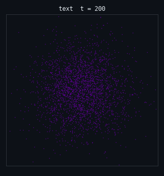
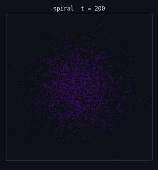
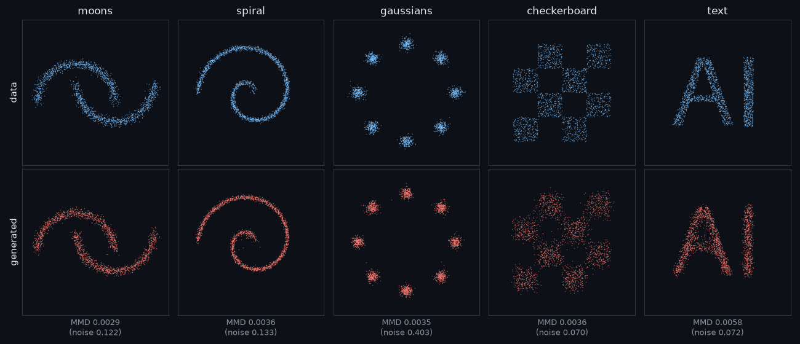
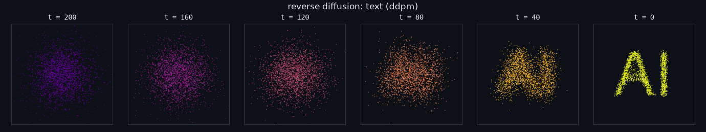

<div align="center">

# 🌫️ tiny-diffusion

**A small, readable denoising diffusion model (DDPM + DDIM) written from scratch in PyTorch. It trains on 2D toy
datasets in about 30 seconds on a laptop CPU, and you can watch noise turn into structure.**

[](https://github.com/hbtabi/tiny-diffusion/actions/workflows/ci.yml)


[](LICENSE)

</div>

Image diffusion models are hard to *see* learning: millions of pixels, hours of GPU time. In 2D you can watch
the whole thing. A cloud of Gaussian noise gets nudged, step by step, into two moons, a spiral, eight blobs,
or the letters **AI**. The core is about 230 lines: a noise schedule, a residual MLP denoiser and two samplers,
each commented with the equation it implements.

## 📸 Demo

<p align="center">
  
  
</p>

<p align="center"></p>

<p align="center"></p>

## ✨ Features

- **From-scratch DDPM**: forward process `q(x_t | x_0)`, ε-prediction objective, ancestral sampling via the
  posterior `q(x_{t-1} | x_t, x̂_0)`
- **DDIM sampler** (η = 0): deterministic, 25 steps instead of 200
- **Linear and cosine** noise schedules (Nichol & Dhariwal), x̂₀ clipping for stable sampling
- **Residual MLP denoiser** with sinusoidal timestep embeddings, LayerNorm, zero-initialised residual branches
  and EMA weights (176k parameters)
- **7 datasets**: moons, spiral, rings, checkerboard, 8 gaussians, heart, and `text` (points sampled from a
  rendered word)
- **Honest metrics**: MMD and Chamfer distance against *fresh* data, always shown next to a pure-noise baseline
- **Visuals**: animated GIF of the reverse process, snapshot strips, data-vs-samples grids, loss curves
- **5 bundled checkpoints** (fp16, ~355 KB each, loaded with `torch.load(weights_only=True)`)

## 🚀 Quick start

```bash
git clone https://github.com/hbtabi/tiny-diffusion && cd tiny-diffusion
python -m venv .venv && source .venv/bin/activate
pip install torch --index-url https://download.pytorch.org/whl/cpu   # CPU wheel; skip if you have torch
pip install -e ".[dev]"

tiny-diffusion sample --ckpt text --gif text.gif          # bundled: moons, spiral, gaussians, checkerboard, text
tiny-diffusion sample --ckpt moons --sampler ddim --ddim-steps 25 --png moons.png
tiny-diffusion train --dataset heart --steps 4000 --out runs/heart.pt --loss-plot loss.png   # ~30 s on CPU
tiny-diffusion eval --ckpt runs/heart.pt
python scripts/make_figures.py                             # regenerate the README figures
```

## 📊 Results

`tiny-diffusion eval` (2,000 samples vs 2,000 fresh data points; lower is better):

| Dataset | MMD (DDPM, 200 steps) | MMD (DDIM, 25 steps) | MMD of pure noise | Chamfer (DDPM) | Chamfer of noise |
|---|---|---|---|---|---|
| moons | 0.0029 | 0.0318 | 0.122 | 0.048 | 0.336 |
| spiral | 0.0037 | 0.0496 | 0.133 | 0.035 | 0.374 |
| gaussians | 0.0035 | 0.0556 | 0.403 | 0.036 | 0.723 |
| checkerboard | 0.0036 | 0.0298 | 0.070 | 0.076 | 0.214 |
| text ("AI") | 0.0058 | 0.0215 | 0.072 | 0.050 | 0.320 |

DDIM is 8× faster but noticeably worse here. With only 25 deterministic steps, the small model's ε errors
aren't averaged out by fresh noise.

## 🧠 How it works

```
training:   x0 ~ data,  t ~ U{0..T-1},  eps ~ N(0, I)
            x_t = sqrt(abar_t) * x0 + sqrt(1 - abar_t) * eps          # schedule.q_sample
            loss = || eps - eps_theta(x_t, t) ||^2                      # diffusion.train

sampling:   x_T ~ N(0, I)
            x0_hat = (x_t - sqrt(1 - abar_t) * eps_theta) / sqrt(abar_t), clipped
            x_{t-1} = posterior_mean(x_t, x0_hat) + sigma_t * z         # schedule.ddpm_step
```

```
tinydiffusion/
  schedule.py   noise schedules, q_sample, DDPM + DDIM steps
  model.py      sinusoidal embeddings + residual MLP denoiser
  diffusion.py  training loop (AdamW, warmup + cosine LR, EMA), samplers, checkpoints
  datasets.py   2D toy datasets (incl. rendered text)
  metrics.py    MMD (multi-bandwidth RBF) and Chamfer distance
  viz.py        GIFs, strips, grids, loss plots (matplotlib, Agg)
  cli.py        datasets | train | sample | eval
checkpoints/    5 small fp16 checkpoints
scripts/        make_figures.py
tests/          schedule maths, exact x0 recovery, shapes, training-beats-noise, CLI
```

## 🛣️ Roadmap

- [ ] 16×16 sprite / glyph images with a tiny U-Net (same schedule code)
- [ ] Classifier-free guidance with dataset labels (e.g. pick which moon)
- [ ] v-prediction and min-SNR loss weighting, compared head-to-head
- [ ] Interactive notebook with sliders for T, schedule and sampler
- [ ] Probability-flow ODE sampler with an adaptive solver

## ⚠️ Limitations

- It's a learning project on 2D points, not an image generator. Pixels need a convolutional U-Net and far more compute.
- Sharp edges are hard. The checkerboard comes out with soft, blurry squares even though its MMD looks good.
  Read the metrics together with the pictures.
- MMD and Chamfer on 2D points are rough proxies. They don't capture everything (e.g. small density errors inside a mode).
- Results depend on seeds and training length. Numbers in the table come from the bundled checkpoints (seed 0, 4,000 steps).

## 📄 License

[MIT](LICENSE) © 2026 Mohammed Hassan bin Tayyeb
